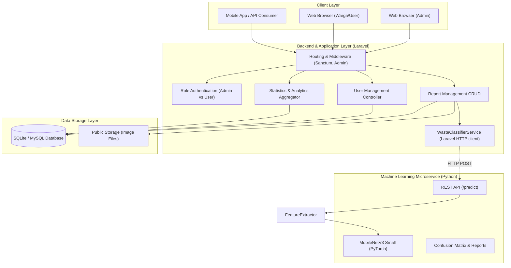

# Smart Waste Management System (SWMS)

[](https://laravel.com)
[](https://python.org)
[](https://tailwindcss.com)
[](https://phpunit.de)

Sistem Pengelolaan Sampah Cerdas berbasis teknologi web modern, integrasi REST API, dan Computer Vision Machine Learning untuk klasifikasi sampah otomatis. Proyek ini dikembangkan secara komprehensif sebagai pemenuhan **Technical Coding Test – Fullstack Developer di Bilcode Technology**.

---

## 📑 Daftar Isi
1. [Arsitektur Sistem](#1-arsitektur-sistem)
2. [Fitur Utama](#2-fitur-utama)
   - [A. Website Development (25%)](#a-website-development)
   - [B. Mobile Development (20%)](#b-mobile-development)
   - [C. Backend & REST API (15%)](#c-backend--rest-api)
   - [D. Machine Learning (20%)](#d-machine-learning)
3. [Skema Database & ERD (5%)](#3-skema-database--erd)
4. [Akun Demo Pengujian](#4-akun-demo-pengujian)
5. [Panduan Instalasi & Penggunaan](#5-panduan-instalasi--penggunaan)
6. [Pengujian Otomatis (Automated Testing)](#6-pengujian-otomatis)
7. [Struktur Direktori Proyek](#7-struktur-direktori-proyek)
8. [Checklist Ketentuan Pengumpulan](#8-checklist-ketentuan-pengumpulan)

---

## 1. Arsitektur Sistem



---

## 2. Fitur Utama

### A. Website Development
- **Autentikasi Berbasis Role**:
  - `Administrator`: Akses penuh statistik seluruh kota, manajemen pengguna, verifikasi & transisi status laporan, catatan audit.
  - `Masyarakat / User`: Dashboard personal, riwayat laporan, pelaporan sampah baru, edit/hapus laporan saat masih berstatus *Pending*.
- **Dashboard Statistik Real-time**:
  - Metrik kartu: Total Laporan, Pending, In Progress, Completed, Rejected.
  - Indikator Tingkat Penyelesaian (*Resolution Rate*) & Rata-rata Akurasi AI.
  - Visualisasi grafik interaktif: Bar Chart tren harian & Doughnut Chart komposisi sampah (Chart.js).
  - Tabel ringkasan laporan terbaru dengan thumbnail dan status badge.
- **Manajemen Laporan Sampah (CRUD Lengkap)**:
  - **Create**: Unggah foto sampah, integrasi prediksi AI instan, pemilihan lokasi interaktif via **Leaflet Map** (draggable marker) & tombol **GPS Geolocation**. Draf formulir dan foto tersimpan otomatis di browser agar tidak hilang saat halaman di-refresh.
  - **Read**: Tampilan daftar laporan dengan filter multi-kriteria dan paginasi.
  - **Detail**: Informasi menyeluruh, foto resolusi tinggi, marker peta interaktif, rekomendasi daur ulang ramah lingkungan, dan **Riwayat Jejak Audit Transisi Status**.
  - **Update**: Edit rincian laporan dan opsi penggantian foto.
  - **Delete**: Hapus laporan beserta pembersihan berkas berkas foto dari penyimpanan.
- **Filter & Pencarian Komprehensif**:
  - Filter status (Semua, Pending, Diproses, Selesai, Ditolak) via status tabs.
  - Filter kategori sampah (Organik, Plastik, Kertas, Lainnya).
  - Pencarian fleksibel kata kunci (judul, lokasi, deskripsi, nama pelapor).
  - Filter rentang tanggal (*Date from - Date to*).
- **Manajemen Pengguna (Khusus Admin)**:
  - Melihat seluruh daftar pengguna beserta peran, kontak, dan jumlah laporan.
  - Tambah pengguna baru dengan pilihan hak akses (Admin / User).
  - Edit identitas dan ubah kata sandi pengguna.
  - Hapus pengguna (proteksi pencegahan self-delete).
- **Alur Kerja Pembaruan Status**:
  - Perubahan status transisi: `Pending` &rarr; `In Progress` &rarr; `Completed` &rarr; `Rejected`.
  - Formulir penyematan catatan tindak lanjut armada operasional oleh admin.
  - Audit trail transisi status tercatat otomatis pada tabel `report_status_logs`.
- **Desain Responsif**: Tampilan antarmuka modern, optimal di layar ponsel (*mobile-friendly*), tablet, dan desktop dengan Tailwind CSS.

---

### B. Mobile Development
- Aplikasi Flutter warga untuk registrasi, login, dan melihat status verifikasi email.
- Dashboard ringkasan serta riwayat laporan milik warga; akun admin diarahkan memakai dashboard website.
- Form laporan mendukung kamera/galeri, foto wajib, koordinat GPS wajib, deskripsi, kategori sampah, dan prediksi AI.
- Menggunakan Laravel API dengan bearer token yang disimpan melalui secure storage.
- Sumber kode berada di [`mobile/`](./mobile). Petunjuk menjalankan aplikasi dan konfigurasi endpoint tersedia pada bagian instalasi.

### C. Backend & REST API
- Dibangun dengan arsitektur RESTful standar, didukung **Laravel Sanctum** untuk pengamanan Bearer Token.
- Endpoint lengkap untuk klien mobile/eksternal:
  - `POST /api/v1/auth/register`
  - `POST /api/v1/auth/login`
  - `GET /api/v1/auth/profile`
  - `POST /api/v1/auth/logout`
  - `POST /api/v1/ai/classify`
  - `GET /api/v1/reports`
  - `POST /api/v1/reports` (Multipart form-data: foto + GPS)
  - `GET /api/v1/reports/{id}`
  - `POST /api/v1/reports/{id}/status` (Khusus Admin)
- Dokumentasi API interaktif dapat diakses pada halaman web: [`/api-docs`](http://localhost:8000/api-docs) atau berkas [`docs/API_DOCUMENTATION.md`](./docs/API_DOCUMENTATION.md).

---

### D. Machine Learning
- **Tiga Kategori Klasifikasi**:
  1. `organic`: Sampah Organik (sisa makanan, sayuran, daun, buah)
  2. `plastic`: Sampah Plastik (botol, kantong kresek, kemasan)
  3. `paper`: Sampah Kertas (kardus, kertas arsip, koran)
- **Dataset**: 150 foto sumber teratribusi (50 organik, 50 plastik, 50 kertas) dengan checksum SHA-256.
- **Evaluasi Model**:
  - **Target Akurasi**: $\ge 80.0\%$
  - Dataset pelatihan berisi 150 foto sumber (50 per kelas) dengan manifest atribusi dan hash pada [`machine-learning/training_photos/`](./machine-learning/training_photos).
  - Pipeline menggunakan split train/validation/test terpisah, deduplikasi berdasarkan SHA-256, early stopping, classification report, confusion matrix, dan checkpoint PyTorch.
  - Evaluasi holdout saat ini: **91,30%** pada 23 foto test (akurasi makro 91,67%); precision/recall/F1 per kelas tersedia di `machine-learning/artifacts/evaluation.json`.
  - Angka ini hanya berlaku pada split kecil dari dataset tersebut; tidak menjamin performa untuk semua foto sampah di dunia nyata.
- **Layanan Microservice**:
  - FastAPI `POST /predict` memuat checkpoint hasil training. Laravel selalu meminta prediksi server-side dan tidak menerima confidence yang dikirim klien.
  - Jika model atau layanan tidak tersedia, klasifikasi gagal secara eksplisit; laporan tidak disimpan dan foto sementara dibersihkan.

---

## 3. Skema Database & ERD

Diagram ERD relasional lengkap beserta kamus data dapat dilihat di berkas [`docs/ERD.md`](./docs/ERD.md).

Ringkasan Entitas Utama:
- `users`: Data pengguna, role (`admin` / `user`), kontak, alamat, avatar.
- `reports`: Data laporan, foto, koordinat GPS (`latitude`, `longitude`), kategori, status alur kerja, confidence score AI.
- `report_status_logs`: Jejak audit setiap perubahan status laporan beserta catatan admin dan waktu.
- `personal_access_tokens`: Token autentikasi API Sanctum untuk integrasi mobile.

---

## 4. Akun Demo Pengujian

Akun dan data demo hanya dibuat oleh seeder saat `APP_ENV=local` atau `testing`.
Jangan gunakan kredensial demo ini di production; provisioning administrator
production harus dilakukan secara terpisah dengan kata sandi unik.

Seeder akun demo mendukung fitur **1-Klik Isi Kredensial** pada halaman login:

| Peran | Alamat Email | Kata Sandi | Deskripsi Akses |
| :--- | :--- | :--- | :--- |
| **Administrator** | `admin@swms.com` | `password` | Hak akses penuh: Dashboard analitik seluruh kota, update status, manajemen pengguna |
| **Warga / User 1**| `user@swms.com` | `password` | Pengguna warga: Buat laporan, kelola laporan pribadi, uji coba AI |
| **Warga / User 2**| `siti@swms.com` | `password` | Pengguna warga kedua dengan data laporan terdaftar |

---

## 5. Panduan Instalasi & Penggunaan

### Kebutuhan Sistem
- PHP $\ge$ 8.2 (dengan ekstensi `pdo_sqlite` / `pdo_mysql`, `gd`, `fileinfo`, `curl`)
- Composer $\ge$ 2.0
- Node.js $\ge$ 18 & NPM (opsional jika ingin memodifikasi aset Vite)
- Python $\ge$ 3.10 (untuk modul Machine Learning)
- Flutter SDK versi stabil (untuk aplikasi mobile)

### Langkah 1: Kloning & Pengaturan Environment
```bash
git clone https://github.com/anhrxf/project-SWMS.git
cd project-SWMS
cp .env.example .env
```

### Langkah 2: Instalasi Dependensi & Database Seeding
```bash
# 1. Install dependensi PHP
composer install

# 2. Generate Application Key
php artisan key:generate

# 3. Jalankan migrasi yang belum diterapkan dan isi data awal tanpa menghapus data
php artisan migrate --seed

# 4. Hubungkan penyimpanan berkas publik
php artisan storage:link
```

`php artisan migrate:fresh` menghapus semua tabel beserta datanya. Gunakan hanya jika
memang ingin mengatur ulang database lokal; jangan gunakan untuk pembaruan rutin.
Seeder tidak membuat akun atau laporan demo di luar environment `local` dan `testing`.
Untuk production, pastikan `APP_DEBUG=false`, gunakan HTTPS, dan atur sendiri kredensial
administrator serta koneksi database yang hanya dapat diakses oleh aplikasi.

### Pengiriman dan verifikasi email

Saat mendaftar, aplikasi mengirim tautan verifikasi jika fitur verifikasi email aktif
(default production; nonaktif untuk `local`/`testing`). Tautan berlaku selama 5 menit,
dengan hitung mundur pada halaman verifikasi. Akun belum dapat
mengakses dashboard, laporan, atau fitur aplikasi sebelum tautan dibuka. Jika email
diubah dari halaman profil, alamat baru harus diverifikasi ulang. Verifikasi membuktikan
bahwa pengguna dapat menerima email tersebut; hal ini tidak memeriksa apakah alamat
terdaftar sebagai akun Google.

Mailer bawaan `.env.example` menggunakan `MAIL_MAILER=log`, sehingga email **tidak
dikirim ke inbox**; isi email hanya dicatat di `storage/logs/laravel.log`. Untuk
mengirim verifikasi melalui Gmail:

1. Aktifkan Verifikasi 2 Langkah pada akun Google pengirim.
2. Buat **App Password** dari pengaturan keamanan akun Google. Password ini berbeda
   dari password login Gmail dan jangan dibagikan atau dimasukkan ke repository.
3. Isi pengaturan berikut di `.env` lokal. `MAIL_USERNAME` dan `MAIL_FROM_ADDRESS`
   harus menggunakan alamat Gmail yang sama:

```dotenv
MAIL_MAILER=smtp
MAIL_SCHEME=smtp
MAIL_HOST=smtp.gmail.com
MAIL_PORT=587
MAIL_USERNAME=alamat-gmail-pengirim@gmail.com
MAIL_PASSWORD=app-password-google-16-karakter
MAIL_FROM_ADDRESS=alamat-gmail-pengirim@gmail.com
MAIL_FROM_NAME="Smart Waste Management"
```

4. Bersihkan cache konfigurasi dan mulai ulang server Laravel:

   ```bash
   php artisan config:clear
   ```

5. Daftarkan akun dengan alamat email lain yang dapat Anda akses dan periksa Inbox
   maupun folder Spam. Untuk menguji SMTP tanpa mendaftar akun baru, kirim ulang
   verifikasi dari halaman verifikasi.

Jika masih tidak terkirim, periksa `storage/logs/laravel.log` untuk pesan error SMTP,
pastikan App Password benar dan tidak menggunakan password akun, serta pastikan
jaringan tidak memblokir koneksi SMTP port 587. `APP_URL` pada deployment harus
mengarah ke alamat publik aplikasi agar tautan bertanda tangan dapat dibuka penerima;
`http://localhost:8000` hanya sesuai untuk pengembangan lokal.

### Langkah 3: Menjalankan Server Web Laravel
```bash
php artisan serve
```
Aplikasi website dapat dibuka pada peramban di: **`http://localhost:8000`**.
Sebelum mengirim laporan atau menggunakan klasifikasi gambar, jalankan Microservice
Machine Learning pada Langkah 5.

### Langkah 4: Menjalankan aplikasi mobile

Pastikan server Laravel aktif, lalu jalankan Flutter Web pada origin yang diizinkan oleh
`SWMS_CORS_ALLOWED_ORIGINS`:

```bash
cd mobile
flutter pub get
flutter run -d chrome --web-port 5000 --dart-define=API_BASE_URL=http://127.0.0.1:8000/api/v1
```

Untuk Android Emulator, jalankan Laravel agar dapat diakses dari emulator dan gunakan
alamat host emulator `10.0.2.2`:

```bash
php artisan serve --host=0.0.0.0 --port=8000
cd mobile
flutter run --dart-define=API_BASE_URL=http://10.0.2.2:8000/api/v1
```

HTTP hanya diizinkan pada Android **debug** build untuk pengembangan lokal. Untuk APK
rilis, gunakan endpoint HTTPS:

```bash
flutter build apk --release --dart-define=API_BASE_URL=https://domain-anda/api/v1
```

Jika Flutter Web dijalankan pada origin lain, tambahkan origin persisnya ke
`SWMS_CORS_ALLOWED_ORIGINS` di `.env`, lalu bersihkan cache konfigurasi Laravel dengan
`php artisan config:clear`. Jangan gunakan wildcard untuk origin aplikasi produksi.
Tes parser model Flutter dijalankan dengan `cd mobile && flutter test`.

---

### Langkah 5: Menyiapkan Model dan Menjalankan Microservice
Layanan AI harus aktif untuk klasifikasi gambar dan penyimpanan laporan. Jika folder foto
dataset belum tersedia, ambil dataset terlebih dahulu:
```bash
cd machine-learning

# Install dependensi ML
python -m pip install -r requirements.txt

# Hanya jika dataset training_photos belum tersedia
python download_training_photos.py

# Train dan evaluasi model; hasil tersimpan di artifacts/
python train.py

# Menjalankan REST API Microservice pada port 8001
python app.py
```
Periksa hasil aktual pada `machine-learning/artifacts/evaluation.json` dan confusion
matrix sebelum menyatakan target akurasi 80% tercapai. URL API Laravel default adalah
`http://127.0.0.1:8001/predict`; ubah `ML_API_URL` di `.env` bila alamat layanan berbeda.
Tanpa checkpoint terlatih, layanan FastAPI gagal saat startup dan Laravel mengembalikan
HTTP 503 untuk permintaan klasifikasi, tanpa menyimpan laporan atau foto yang gagal.

---

## 6. Pengujian Otomatis

Aplikasi dilengkapi dengan rangkaian unit & feature test komprehensif menggunakan PHPUnit:

```bash
php artisan test
```

Jalankan juga `cd mobile && flutter analyze` dan `flutter test` untuk memeriksa aplikasi
Flutter. Tes endpoint FastAPI menggunakan `cd machine-learning && python -m unittest test_fastapi_app -v`.
Build APK memerlukan Android SDK dan Java yang terpasang.

---

## 7. Struktur Direktori Proyek

```text
project-SWMS/
├── app/
│   ├── Http/
│   │   ├── Controllers/
│   │   │   ├── Api/                    # REST API Controllers (Sanctum)
│   │   │   ├── AuthController.php      # Login, Register, Profile
│   │   │   ├── DashboardController.php # Statistik & Chart Analytics
│   │   │   ├── ReportController.php    # CRUD Laporan & Transisi Status
│   │   │   ├── UserController.php      # Manajemen Pengguna (Admin)
│   │   │   └── AiController.php        # AI Classification Playground & AJAX
│   │   └── Middleware/
│   │       └── EnsureAdmin.php         # Proteksi Role Admin
│   ├── Models/
│   │   ├── User.php                    # Model Pengguna & Role Checkers
│   │   ├── Report.php                  # Model Laporan Sampah & Helper Badges
│   │   └── ReportStatusLog.php         # Model Jejak Audit Transisi Status
│   └── Services/
│       └── WasteClassifierService.php  # Layanan Klasifikasi Gambar Cerdas
├── database/
│   ├── migrations/                     # Skema Basis Data Lengkap
│   └── seeders/DatabaseSeeder.php      # Seeder Akun Demo & Sampel Laporan
├── docs/
│   ├── PRD.md                          # Product Requirement Document (Alur Admin & User)
│   ├── ERD.md                          # Dokumentasi ERD & Kamus Data
│   ├── API_DOCUMENTATION.md            # Dokumentasi Endpoint REST API
│   ├── SUBMISSION_CHECKLIST.md         # Status dan daftar persiapan pengumpulan
├── machine-learning/
│   ├── training_photos/                # 150 foto dan manifest sumber/hash
│   ├── download_training_photos.py     # Pengunduh dataset dengan revision tetap
│   ├── classifier.py                   # MobileNetV3 dan transformasi gambar
│   ├── train.py                        # Pipeline training & evaluasi holdout
│   ├── fastapi_app.py                  # REST API prediksi FastAPI
│   ├── artifacts/                      # Checkpoint dan metrik hasil training
│   └── README.md                       # Panduan Teknis Machine Learning
├── resources/views/                    # Antarmuka Blade Responsif
│   ├── layouts/app.blade.php           # Master Layout (Sidebar, Navbar, Toast)
│   ├── auth/                           # Halaman Login & Register
│   ├── dashboard/                      # Dashboard Statistik & Grafik
│   ├── reports/                        # CRUD Laporan, Map Picker, Detail Audit
│   ├── users/                          # Manajemen Pengguna
│   ├── ai/                             # AI Waste Classification Sandbox Lab
│   └── docs/api.blade.php              # Tampilan Dokumentasi API Terintegrasi
├── routes/
│   ├── web.php                         # Rute Web & Proteksi Middleware
│   └── api.php                         # Rute REST API v1
├── tests/Feature/SwmsSystemTest.php    # Automated Test Suite
└── README.md                           # Dokumentasi Utama Proyek
```

---

## 8. Checklist Ketentuan Pengumpulan

- [x] **Source Code & Panduan**: Struktur proyek dan instruksi instalasi tersedia di repository.
- [x] **Website Development (Laravel)**: Role authentication (Admin & User), dashboard statistik, CRUD laporan, filter & search, manajemen pengguna, update status (Pending, In Progress, Completed, Rejected), desain responsif.
- [x] **Integrasi AI Image Detection**: Live visual classification, confidence meter, rekomendasi daur ulang.
- [x] **REST API & Integrasi**: Dokumentasi API lengkap (`/api-docs` & `docs/API_DOCUMENTATION.md`), endpoint CRUD dan upload foto.
- [x] **Database Schema & ERD**: Diagram Mermaid dan kamus data komprehensif (`docs/ERD.md`).
- [x] **Machine Learning source**: Dataset 150 foto, tiga kategori, training pipeline, API FastAPI, dan laporan metrik saat training.
- [x] **Target akurasi 80%**: Evaluasi aktual mencapai 91,30% pada 23 sampel test; batasan dataset kecil dijelaskan di dokumentasi.
- [ ] **Demo website publik**: Belum di-deploy; URL harus dilengkapi sebelum pengumpulan.
- [ ] **APK release**: Belum dibuat; build setelah URL API production HTTPS tersedia dan uji di perangkat Android.
- [ ] **Video demo (maks. 10 menit)**: Belum direkam; siapkan naskah demo lokal dan unggah video yang dapat diakses reviewer.
- [x] **Panduan Instalasi**: Dokumentasi langkah demi langkah tersedia di README.
- [ ] **Checklist pengumpulan**: Periksa status dan langkah publikasi pada [`docs/SUBMISSION_CHECKLIST.md`](./docs/SUBMISSION_CHECKLIST.md).

---
*Dikembangkan dengan dedikasi untuk Technical Coding Test – Fullstack Developer Bilcode Technology.*
