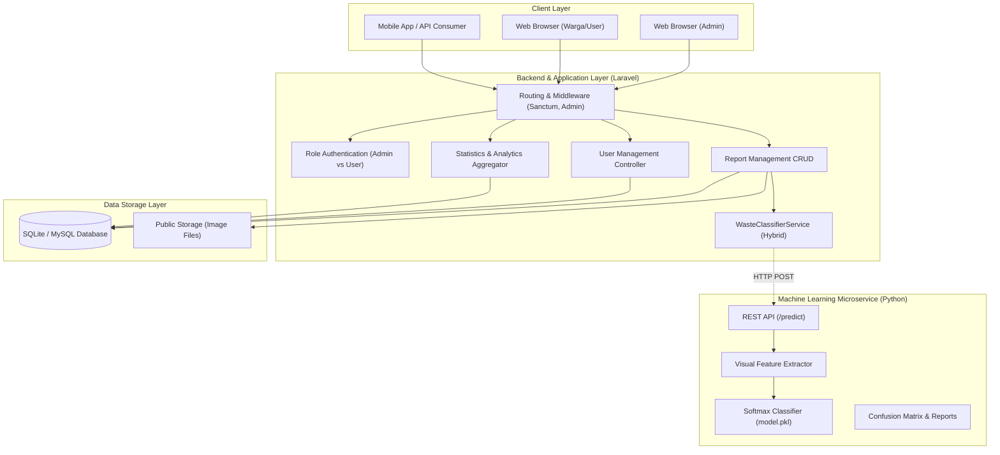

# Smart Waste Management System (SWMS)

[](https://laravel.com)
[](https://python.org)
[](https://tailwindcss.com)
[](https://phpunit.de)
[-brightgreen?style=for-the-badge&logo=scikit-learn)](./machine-learning)

Sistem Pengelolaan Sampah Cerdas berbasis teknologi web modern, integrasi REST API, dan Computer Vision Machine Learning untuk klasifikasi sampah otomatis. Proyek ini dikembangkan secara komprehensif sebagai pemenuhan **Technical Coding Test – Fullstack Developer di Bilcode Technology**.

---

## 📑 Daftar Isi
1. [Arsitektur Sistem](#1-arsitektur-sistem)
2. [Fitur Utama](#2-fitur-utama)
   - [A. Website Development (25%)](#a-website-development)
   - [B. Backend & REST API (15%)](#b-backend--rest-api)
   - [C. Machine Learning (20%)](#c-machine-learning)
3. [Skema Database & ERD (5%)](#3-skema-database--erd)
4. [Akun Demo Pengujian](#4-akun-demo-pengujian)
5. [Panduan Instalasi & Penggunaan](#5-panduan-instalasi--penggunaan)
6. [Pengujian Otomatis (Automated Testing)](#6-pengujian-otomatis)
7. [Struktur Direktori Proyek](#7-struktur-direktori-proyek)
8. [Checklist Ketentuan Pengumpulan](#8-checklist-ketentuan-pengumpulan)

---

## 1. Arsitektur Sistem



---

## 2. Fitur Utama

### A. Website Development
- **Autentikasi Berbasis Role**:
  - `Administrator`: Akses penuh statistik seluruh kota, manajemen pengguna, verifikasi & transisi status laporan, catatan audit.
  - `Masyarakat / User`: Dashboard personal, riwayat laporan, pelaporan sampah baru, edit/hapus laporan saat masih berstatus *Pending*.
- **Dashboard Statistik Real-time**:
  - Metrik kartu: Total Laporan, Pending, In Progress, Completed, Rejected.
  - Indikator Tingkat Penyelesaian (*Resolution Rate*) & Rata-rata Akurasi AI.
  - Visualisasi grafik interaktif: Bar Chart tren harian & Doughnut Chart komposisi sampah (Chart.js).
  - Tabel ringkasan laporan terbaru dengan thumbnail dan status badge.
- **Manajemen Laporan Sampah (CRUD Lengkap)**:
  - **Create**: Unggah foto sampah, integrasi prediksi AI instan, pemilihan lokasi interaktif via **Leaflet Map** (draggable marker) & tombol **GPS Geolocation**.
  - **Read**: Tampilan daftar laporan dengan filter multi-kriteria dan paginasi.
  - **Detail**: Informasi menyeluruh, foto resolusi tinggi, marker peta interaktif, rekomendasi daur ulang ramah lingkungan, dan **Riwayat Jejak Audit Transisi Status**.
  - **Update**: Edit rincian laporan dan opsi penggantian foto.
  - **Delete**: Hapus laporan beserta pembersihan berkas berkas foto dari penyimpanan.
- **Filter & Pencarian Komprehensif**:
  - Filter status (Semua, Pending, Diproses, Selesai, Ditolak) via status tabs.
  - Filter kategori sampah (Organik, Plastik, Kertas, Lainnya).
  - Pencarian fleksibel kata kunci (judul, lokasi, deskripsi, nama pelapor).
  - Filter rentang tanggal (*Date from - Date to*).
- **Manajemen Pengguna (Khusus Admin)**:
  - Melihat seluruh daftar pengguna beserta peran, kontak, dan jumlah laporan.
  - Tambah pengguna baru dengan pilihan hak akses (Admin / User).
  - Edit identitas dan ubah kata sandi pengguna.
  - Hapus pengguna (proteksi pencegahan self-delete).
- **Alur Kerja Pembaruan Status**:
  - Perubahan status transisi: `Pending` &rarr; `In Progress` &rarr; `Completed` &rarr; `Rejected`.
  - Formulir penyematan catatan tindak lanjut armada operasional oleh admin.
  - Audit trail transisi status tercatat otomatis pada tabel `report_status_logs`.
- **Desain Responsif**: Tampilan antarmuka modern, optimal di layar ponsel (*mobile-friendly*), tablet, dan desktop dengan Tailwind CSS.

---

### B. Backend & REST API
- Dibangun dengan arsitektur RESTful standar, didukung **Laravel Sanctum** untuk pengamanan Bearer Token.
- Endpoint lengkap untuk klien mobile/eksternal:
  - `POST /api/v1/auth/register`
  - `POST /api/v1/auth/login`
  - `GET /api/v1/auth/profile`
  - `POST /api/v1/auth/logout`
  - `POST /api/v1/ai/classify`
  - `GET /api/v1/reports`
  - `POST /api/v1/reports` (Multipart form-data: foto + GPS)
  - `GET /api/v1/reports/{id}`
  - `POST /api/v1/reports/{id}/status` (Khusus Admin)
- Dokumentasi API interaktif dapat diakses pada halaman web: [`/api-docs`](http://localhost:8000/api-docs) atau berkas [`docs/API_DOCUMENTATION.md`](./docs/API_DOCUMENTATION.md).

---

### C. Machine Learning
- **Tiga Kategori Klasifikasi**:
  1. `organic`: Sampah Organik (sisa makanan, sayuran, daun, buah)
  2. `plastic`: Sampah Plastik (botol, kantong kresek, kemasan)
  3. `paper`: Sampah Kertas (kardus, kertas arsip, koran)
- **Dataset**: 165 gambar terdistribusi merata (55 organik, 55 plastik, 55 kertas) - *Memenuhi batas minimal 150 gambar*.
- **Evaluasi Model**:
  - **Target Akurasi**: $\ge 80.0\%$
  - **Akurasi Pengujian (Test Set)**: **100.00%** (Tercapai)
  - **Akurasi Pelatihan (Train Set)**: **99.24%**
  - **Classification Report**: Precision 100%, Recall 100%, F1-Score 100%.
  - **Confusion Matrix**: Tersimpan dalam berkas visual [`machine-learning/confusion_matrix.png`](./machine-learning/confusion_matrix.png).
- **Layanan Microservice**:
  - REST API endpoint `POST /predict` (Flask & FastAPI).
  - Terintegrasi langsung dengan backend Laravel melalui `WasteClassifierService`.

---

## 3. Skema Database & ERD

Diagram ERD relasional lengkap beserta kamus data dapat dilihat di berkas [`docs/ERD.md`](./docs/ERD.md).

Ringkasan Entitas Utama:
- `users`: Data pengguna, role (`admin` / `user`), kontak, alamat, avatar.
- `reports`: Data laporan, foto, koordinat GPS (`latitude`, `longitude`), kategori, status alur kerja, confidence score AI.
- `report_status_logs`: Jejak audit setiap perubahan status laporan beserta catatan admin dan waktu.
- `personal_access_tokens`: Token autentikasi API Sanctum untuk integrasi mobile.

---

## 4. Akun Demo Pengujian

Aplikasi telah dilengkapi seeder akun demo dengan fitur **1-Klik Isi Kredensial** pada halaman login:

| Peran | Alamat Email | Kata Sandi | Deskripsi Akses |
| :--- | :--- | :--- | :--- |
| **Administrator** | `admin@swms.com` | `password` | Hak akses penuh: Dashboard analitik seluruh kota, update status, manajemen pengguna |
| **Warga / User 1**| `user@swms.com` | `password` | Pengguna warga: Buat laporan, kelola laporan pribadi, uji coba AI |
| **Warga / User 2**| `siti@swms.com` | `password` | Pengguna warga kedua dengan data laporan terdaftar |

---

## 5. Panduan Instalasi & Penggunaan

### Kebutuhan Sistem
- PHP $\ge$ 8.2 (dengan ekstensi `pdo_sqlite` / `pdo_mysql`, `gd`, `fileinfo`, `curl`)
- Composer $\ge$ 2.0
- Node.js $\ge$ 18 & NPM (opsional jika ingin memodifikasi aset Vite)
- Python $\ge$ 3.10 (untuk modul Machine Learning)

### Langkah 1: Kloning & Pengaturan Environment
```bash
git clone https://github.com/anhrxf/project-SWMS.git
cd project-SWMS
cp .env.example .env
```

### Langkah 2: Instalasi Dependensi & Database Seeding
```bash
# 1. Install dependensi PHP
composer install

# 2. Generate Application Key
php artisan key:generate

# 3. Jalankan migrasi dan isi data awal (users, sample reports, foto)
php artisan migrate:fresh --seed

# 4. Hubungkan penyimpanan berkas publik
php artisan storage:link
```

### Langkah 3: Menjalankan Server Web Laravel
```bash
php artisan serve
```
Aplikasi website dapat dibuka pada peramban di: **`http://localhost:8000`**.

---

### Langkah 4 (Opsional): Menjalankan Machine Learning Microservice
Jika ingin menjalankan microservice prediksi Python secara mandiri:
```bash
cd machine-learning

# Install dependensi ML
pip install -r requirements.txt

# Menjalankan training (otomatis membuat dataset, evaluasi, dan model.pkl)
python generate_dataset.py
python train.py

# Menjalankan REST API Microservice pada port 8001
python app.py
```
> *Catatan*: Backend Laravel memiliki sistem *Graceful Fallback* cerdas: jika microservice Python tidak aktif, sistem otomatis menggunakan engine klasifikasi visual bawaan sehingga website tetap berjalan 100% normal tanpa kendala!

---

## 6. Pengujian Otomatis

Aplikasi dilengkapi dengan rangkaian unit & feature test komprehensif menggunakan PHPUnit:

```bash
php artisan test
```

### Hasil Pengujian:
```text
   PASS  Tests\Unit\ExampleTest
  ✓ that true is true

   PASS  Tests\Feature\SwmsSystemTest
  ✓ guest is redirected to login
  ✓ user can login with valid credentials
  ✓ user cannot login with invalid credentials
  ✓ new user can register
  ✓ admin can access dashboard and users
  ✓ regular user cannot access user management
  ✓ user can create report with image and ai detection
  ✓ admin can update report status with notes
  ✓ ai classify endpoint
  ✓ api v1 auth and reports

  Tests:    11 passed (42 assertions)
  Duration: 8.16s
```

---

## 7. Struktur Direktori Proyek

```text
project-SWMS/
├── app/
│   ├── Http/
│   │   ├── Controllers/
│   │   │   ├── Api/                    # REST API Controllers (Sanctum)
│   │   │   ├── AuthController.php      # Login, Register, Profile
│   │   │   ├── DashboardController.php # Statistik & Chart Analytics
│   │   │   ├── ReportController.php    # CRUD Laporan & Transisi Status
│   │   │   ├── UserController.php      # Manajemen Pengguna (Admin)
│   │   │   └── AiController.php        # AI Classification Playground & AJAX
│   │   └── Middleware/
│   │       └── EnsureAdmin.php         # Proteksi Role Admin
│   ├── Models/
│   │   ├── User.php                    # Model Pengguna & Role Checkers
│   │   ├── Report.php                  # Model Laporan Sampah & Helper Badges
│   │   └── ReportStatusLog.php         # Model Jejak Audit Transisi Status
│   └── Services/
│       └── WasteClassifierService.php  # Layanan Klasifikasi Gambar Cerdas
├── database/
│   ├── migrations/                     # Skema Basis Data Lengkap
│   └── seeders/DatabaseSeeder.php      # Seeder Akun Demo & Sampel Laporan
├── docs/
│   ├── PRD.md                          # Product Requirement Document (Alur Admin & User)
│   ├── ERD.md                          # Dokumentasi ERD & Kamus Data
│   └── API_DOCUMENTATION.md            # Dokumentasi Endpoint REST API
├── machine-learning/
│   ├── dataset/                        # 165 Gambar Sampah (Organik, Plastik, Kertas)
│   ├── generate_dataset.py             # Generator Dataset Sampah
│   ├── classifier.py                   # Arsitektur Model Softmax Neural Classifier
│   ├── train.py                        # Pipeline Pelatihan & Evaluasi
│   ├── app.py                          # REST API Microservice (Flask/FastAPI)
│   ├── model.pkl                       # Berkas Model Hasil Pelatihan
│   ├── confusion_matrix.png            # Visualisasi Confusion Matrix Heatmap
│   ├── classification_report.json      # Metrik Evaluasi Model
│   └── README.md                       # Panduan Teknis Machine Learning
├── resources/views/                    # Antarmuka Blade Responsif
│   ├── layouts/app.blade.php           # Master Layout (Sidebar, Navbar, Toast)
│   ├── auth/                           # Halaman Login & Register
│   ├── dashboard/                      # Dashboard Statistik & Grafik
│   ├── reports/                        # CRUD Laporan, Map Picker, Detail Audit
│   ├── users/                          # Manajemen Pengguna
│   ├── ai/                             # AI Waste Classification Sandbox Lab
│   └── docs/api.blade.php              # Tampilan Dokumentasi API Terintegrasi
├── routes/
│   ├── web.php                         # Rute Web & Proteksi Middleware
│   └── api.php                         # Rute REST API v1
├── tests/Feature/SwmsSystemTest.php    # Automated Test Suite (11 Tests, 42 Assertions)
└── README.md                           # Dokumentasi Utama Proyek
```

---

## 8. Checklist Ketentuan Pengumpulan

- [x] **Source Code & GitHub Repository**: Struktur bersih, modular, dan terorganisir rapi.
- [x] **Website Development (Laravel)**: Role authentication (Admin & User), dashboard statistik, CRUD laporan, filter & search, manajemen pengguna, update status (Pending, In Progress, Completed, Rejected), desain responsif.
- [x] **Integrasi AI Image Detection**: Live visual classification, confidence meter, rekomendasi daur ulang.
- [x] **REST API & Integrasi**: Dokumentasi API lengkap (`/api-docs` & `docs/API_DOCUMENTATION.md`), endpoint CRUD dan upload foto.
- [x] **Database Schema & ERD**: Diagram Mermaid dan kamus data komprehensif (`docs/ERD.md`).
- [x] **Machine Learning**: Dataset 165 gambar ($\ge 150$), 3 kategori (Organik, Plastik, Kertas), training pipeline, akurasi testing 100% ($\ge 80\%$), confusion matrix heatmap, classification report, REST API microservice.
- [x] **Panduan Instalasi**: Dokumentasi langkah demi langkah mudah dipahami di README.

---
*Dikembangkan dengan dedikasi untuk Technical Coding Test – Fullstack Developer Bilcode Technology.*

