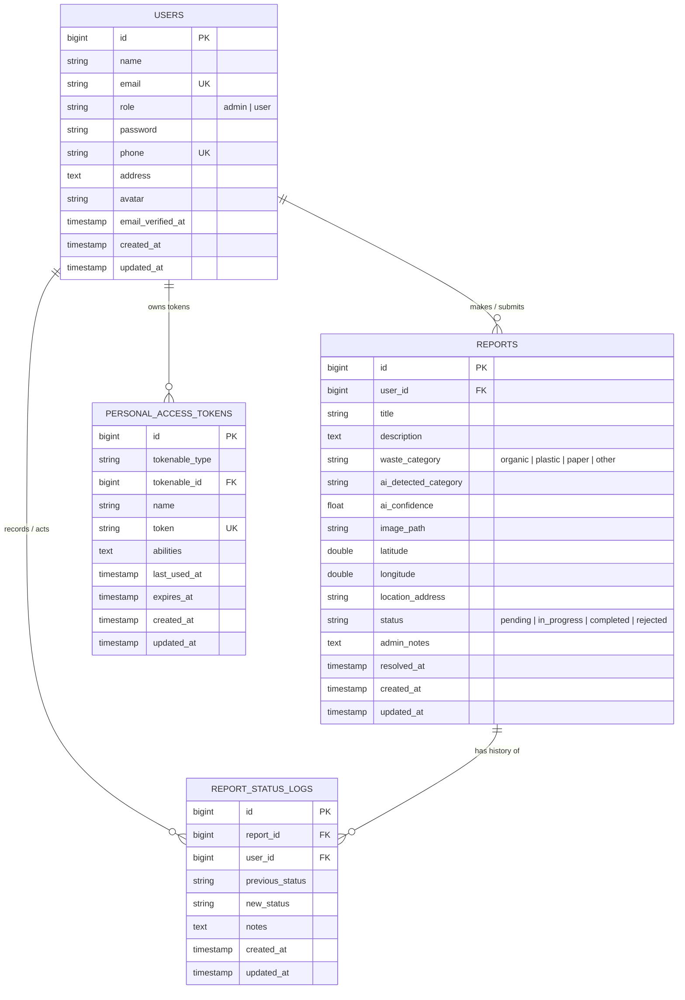

# Entity Relationship Diagram (ERD) - Smart Waste Management System

Dokumentasi rancangan basis data relational untuk **Smart Waste Management System (SWMS)**.

---

## 1. Diagram ERD (Mermaid)

---

## 2. Rincian Kamus Data (Data Dictionary)

### A. Tabel `users`
Menyimpan informasi identitas pengguna dan otorisasi hak akses (Role).

| Kolom | Tipe Data | Nullable | Keterangan |
| :--- | :--- | :---: | :--- |
| `id` | BIGINT UNSIGNED | Tidak | Primary Key, Auto Increment |
| `name` | VARCHAR(255) | Tidak | Nama lengkap pengguna |
| `email` | VARCHAR(255) | Tidak | Alamat surel unik untuk autentikasi (Valid RFC & DNS domain aktif) |
| `role` | VARCHAR(50) | Tidak | Hak akses: `'admin'` (Petugas/DLH) atau `'user'` (Masyarakat) |
| `password` | VARCHAR(255) | Tidak | Hashing kata sandi Bcrypt |
| `phone` | VARCHAR(20) | Tidak | Nomor HP unik (1 nomor HP = 1 akun) |
| `address` | TEXT | Ya | Domisili / Wilayah pelapor |
| `avatar` | VARCHAR(255) | Ya | Path foto profil pengguna |
| `created_at` | TIMESTAMP | Ya | Waktu akun didaftarkan |
| `updated_at` | TIMESTAMP | Ya | Waktu terakhir akun diperbarui |

### B. Tabel `reports`
Menyimpan data laporan kondisi sampah dari masyarakat.

| Kolom | Tipe Data | Nullable | Keterangan |
| :--- | :--- | :---: | :--- |
| `id` | BIGINT UNSIGNED | Tidak | Primary Key, Auto Increment |
| `user_id` | BIGINT UNSIGNED | Tidak | Foreign Key ke `users.id` (ON DELETE CASCADE) |
| `title` | VARCHAR(255) | Tidak | Ringkasan / Judul laporan |
| `description` | TEXT | Tidak | Uraian rinci kondisi sampah di lapangan |
| `waste_category` | VARCHAR(50) | Tidak | Kategori: `organic`, `plastic`, `paper`, `other` |
| `ai_detected_category`| VARCHAR(50) | Ya | Kategori hasil klasifikasi model Computer Vision AI |
| `ai_confidence` | FLOAT | Ya | Skor keyakinan model AI (0.00% - 100.00%) |
| `image_path` | VARCHAR(255) | Tidak | Lokasi file foto bukti sampah di storage |
| `latitude` | DOUBLE(10, 7) | Ya | Titik koordinat lintang GPS |
| `longitude` | DOUBLE(10, 7) | Ya | Titik koordinat bujur GPS |
| `location_address` | VARCHAR(500) | Ya | Alamat jalan / patokan lokasi fisik |
| `status` | ENUM | Tidak | Status alur kerja: `pending`, `in_progress`, `completed`, `rejected` |
| `admin_notes` | TEXT | Ya | Catatan tindakan petugas operasional |
| `resolved_at` | TIMESTAMP | Ya | Waktu laporan selesai ditangani |
| `created_at` | TIMESTAMP | Ya | Waktu pembuatan laporan |
| `updated_at` | TIMESTAMP | Ya | Waktu pembaruan terakhir |

### C. Tabel `report_status_logs`
Menyimpan riwayat jejak audit (Audit Trail) atas setiap transisi status laporan.

| Kolom | Tipe Data | Nullable | Keterangan |
| :--- | :--- | :---: | :--- |
| `id` | BIGINT UNSIGNED | Tidak | Primary Key, Auto Increment |
| `report_id` | BIGINT UNSIGNED | Tidak | Foreign Key ke `reports.id` (ON DELETE CASCADE) |
| `user_id` | BIGINT UNSIGNED | Ya | Foreign Key ke `users.id` (Aktor yang mengubah status) |
| `previous_status` | VARCHAR(50) | Ya | Status sebelum diubah |
| `new_status` | VARCHAR(50) | Tidak | Status baru yang ditetapkan |
| `notes` | TEXT | Ya | Catatan audit / alasan perubahan status |
| `created_at` | TIMESTAMP | Ya | Waktu pencatatan log |
| `updated_at` | TIMESTAMP | Ya | Waktu pembaruan log |

### D. Tabel `personal_access_tokens`
Disediakan oleh **Laravel Sanctum** untuk mengelola Bearer Token autentikasi REST API aplikasi mobile dan klien eksternal.

---

## 3. Aturan Bisnis & Integritas Data (Business Rules)
1. **Otorisasi Role**:
   - `admin`: Memiliki hak akses penuh melihat seluruh laporan, mengelola pengguna (CRUD), mengubah status laporan (Pending &rarr; In Progress &rarr; Completed &rarr; Rejected), dan mencatat log tindakan.
   - `user`: Hanya dapat melihat laporannya sendiri dan membuat laporan baru. Pengguna dapat mengedit/menghapus laporan miliknya selama statusnya masih `pending`.
2. **Keterikatan Relasi**:
   - Setiap laporan wajib memiliki 1 pelapor (`users`).
   - Setiap perubahan status pada tabel `reports` secara otomatis mendokumentasikan entri baru di tabel `report_status_logs`.
   - Ketika status laporan diubah ke `completed`, kolom `resolved_at` otomatis terisi dengan timestamp saat itu.
