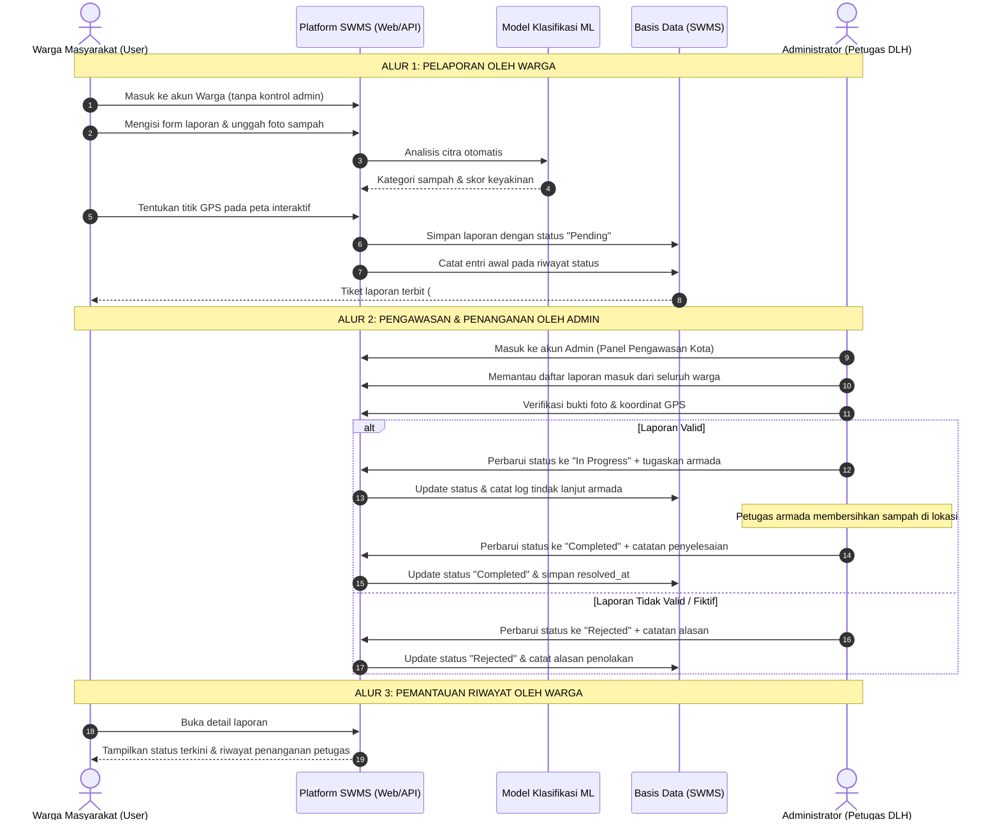

# Product Requirement Document (PRD)
## Smart Waste Management System (SWMS)

| Parameter | Keterangan |
| :--- | :--- |
| **Nama Produk** | Smart Waste Management System (SWMS) |
| **Versi Dokumen** | 1.1.0 |
| **Status** | Disetujui / Implementasi Selesai |
| **Target Pengguna** | Masyarakat Umum (Warga Pelapor) & Administrator (Petugas DLH / Operator Kebersihan) |
| **Arsitektur Inti** | Laravel 11/13 (Monolith + REST API), SQLite/MySQL, Python ML Microservice |

---

## 1. Latar Belakang & Tujuan Produk

Pengelolaan timbunan sampah di wilayah perkotaan sering terkendala oleh keterbatasan pelaporan masyarakat yang lambat, data lokasi yang tidak akurat, serta belum adanya klasifikasi jenis sampah otomatis untuk menentukan metode pengolahan yang tepat.

**Smart Waste Management System (SWMS)** hadir sebagai platform terintegrasi untuk:
1. **Mempermudah Warga** melaporkan titik tumpukan sampah secara *real-time* disertai bukti foto, koordinat GPS akurat, dan deteksi klasifikasi otomatis berbasis *Computer Vision*.
2. **Memberdayakan Administrator / Petugas** dengan dasbor analitik terpusat, pengawasan status se-kota, penugasan armada kebersihan, dan pencatatan jejak audit (*audit trail*) transparan.
3. **Mengotomatisasi Klasifikasi Sampah** ke dalam 3 kategori utama (*Organic Waste*, *Plastic Waste*, *Paper Waste*) guna memandu rantai daur ulang (*circular economy*).

---

## 2. Persona Pengguna (User Personas)

### Persona A: Warga Masyarakat (Role: `user`)
- **Tujuan**: Melaporkan tumpukan sampah di lingkungannya secara cepat, memantau penanganan oleh dinas, dan mengetahui cara pengolahan/daur ulang yang tepat.
- **Karakteristik**:
  - Mengakses sistem melalui peramban ponsel pintar (*mobile web*) atau aplikasi.
  - Membutuhkan antarmuka yang sederhana, deteksi foto otomatis, dan penentuan lokasi instan dengan GPS.
- **Aktivitas Utama**:
  - Registrasi & login akun warga.
  - Membuat laporan sampah dengan foto dan titik lokasi pada peta.
  - Memantau tahapan status laporannya (*Pending* $\rightarrow$ *In Progress* $\rightarrow$ *Completed*).
  - Melakukan penyuntingan atau pembatalan laporan selama masih berstatus *Pending*.

### Persona B: Administrator / Petugas Kebersihan (Role: `admin`)
- **Tujuan**: Memverifikasi keabsahan laporan warga, menugaskan armada pembersih, memantau rasio penyelesaian laporan, dan mengelola akun pengguna sistem.
- **Karakteristik**:
  - Mengakses melalui perangkat tablet atau komputer desktop kantor dinas.
  - Membutuhkan visibilitas menyeluruh terhadap seluruh laporan kota dan alat audit status.
- **Aktivitas Utama**:
  - Memantau metrik dasbor (Total Laporan, Rasio Penyelesaian, Distribusi Kategori).
  - Memfilter laporan berdasarkan status, kategori, kata kunci, dan rentang tanggal.
  - Memperbarui status laporan disertai catatan verifikasi/tindak lanjut armada operasional.
  - Mengelola data akun pengguna (tambah, edit hak akses, nonaktifkan).

---

## 3. Matriks Otorisasi & Hak Akses (RBAC Matrix)

Pemisahan tugas (*Separation of Concerns*) antar-peran ditegakkan secara ketat pada level Controller, Middleware, UI, dan API:

| Fitur / Tindakan | Tamu (Guest) | Warga (`user`) | Administrator (`admin`) | Batasan & Keterangan Alur |
| :--- | :---: | :---: | :---: | :--- |
| **Halaman Login & Registrasi** | ✅ | ❌ (Dialihkan) | ❌ (Dialihkan) | Form login standar bersih tanpa kebocoran kontrol admin |
| **Dasbor Statistik** | ❌ | ✅ (Personal) | ✅ (Agregat Kota) | Warga memantau laporannya; Admin memantau seluruh wilayah |
| **Membuat Laporan Sampah** | ❌ | ✅ | ❌ (Ditolak) | **Hanya Warga yang melapor**; Admin bertugas memantau |
| **Melihat Daftar Laporan** | ❌ | ✅ (Laporan Sendiri) | ✅ (Seluruh Laporan) | Admin menyaring antrian verifikasi laporan masyarakat |
| **Melihat Detail Laporan** | ❌ | ✅ (Laporan Sendiri) | ✅ (Semua Laporan) | Menampilkan foto, peta koordinat GPS, dan riwayat status |
| **Mengedit / Menghapus Laporan**| ❌ | ✅ (Hanya status *Pending*) | ❌ (Ditolak) | Isi laporan adalah hak orisinil pelapor; Admin tidak mengutak-atik isi |
| **Memperbarui Status Laporan** | ❌ | ❌ (Terproteksi) | ✅ (*Workflow Manager*) | Transisi status (*Pending* &rarr; *In Progress* &rarr; *Completed* / *Rejected*) |
| **Menyematkan Catatan Armada** | ❌ | ❌ | ✅ | Dokumentasi catatan armada kebersihan atau alasan verifikasi |
| **Melihat Riwayat Status** | ❌ | ✅ (Laporan Sendiri) | ✅ (Semua Laporan) | Transparansi jejak audit (*audit trail*) bagi warga dan petugas |
| **Manajemen Pengguna (CRUD)** | ❌ | ❌ (403 Forbidden) | ✅ | Mengelola hak akses akun staf dan warga |
| **Uji Coba AI Lab** | ❌ | ✅ | ✅ | Pengujian model klasifikasi citra sampah |

---

## 4. Alur Kerja Sistem (System Workflows)

### 4.1. Alur Pengguna (User Journey) Berdasarkan Peran



---

### 4.2. Siklus Hidup Status Laporan (State Machine Lifecycle)

Laporan memiliki alur transisi status yang kaku guna menjaga integritas data dan jejak audit:

```mermaid
stateDiagram-v2
    [*] --> Pending : Warga membuat laporan baru

    state "Pending (Menunggu Verifikasi)" as Pending {
        note right of Pending
            - Warga dapat mengedit/menghapus
            - Menunggu verifikasi petugas DLH
            - Admin BELUM menugaskan armada
        end note
    }

    state "In Progress (Sedang Ditindaklanjuti)" as InProgress {
        note right of InProgress
            - Laporan terkunci permanen dari edit warga
            - Armada kebersihan ditugaskan ke lokasi
        end note
    }

    state "Completed (Selesai Ditangani)" as Completed {
        note right of Completed
            - Sampah telah diangkut ke TPS/Bank Sampah
            - Cap waktu resolved_at terisi otomatis
        end note
    }

    state "Rejected (Ditolak / Tidak Valid)" as Rejected {
        note right of Rejected
            - Foto tidak jelas / titik fiktif / duplikat
            - Catatan alasan verifikasi dicatat admin
        end note
    }

    Pending --> InProgress : Admin memverifikasi & menugaskan armada
    Pending --> Rejected : Admin menolak dengan alasan resmi
    InProgress --> Completed : Admin mengonfirmasi pembersihan tuntas
    InProgress --> Rejected : Pembatalan tindak lanjut jika kendala lapangan
    Completed --> InProgress : Tindak lanjut ulang jika sampah belum tuntas
```

---

## 5. Rincian Kebutuhan Fungsional (Functional Requirements)

### FR-01: Autentikasi & Profil Akun
1. **Aturan 1 Nomor HP = 1 Akun**: Nomor telepon/HP bersifat unik wajib diisi (`unique:users,phone`). Satu nomor HP hanya dapat digunakan untuk satu akun terdaftar; pendaftaran dengan nomor HP yang telah ada otomatis ditolak.
2. **Keunikan Email & Validitas Domain Real Life**: Alamat email wajib unik (`unique:users,email`) dan diverifikasi formatnya menggunakan standar RFC serta pengecekan DNS/MX domain aktif di internet (misalnya Google Mail `@gmail.com`, Yahoo, dsb.), menolak domain fiktif.
3. **Pemisahan Peran**: Sistem membedakan hak akses dan alur kerja antara Administrator dan Warga.
4. **Pengaturan Profil**: Pengguna dapat memperbarui nama, nomor kontak (tetap terikat aturan unik), domisili, dan mengganti kata sandi.

### FR-02: Manajemen Laporan Sampah (CRUD)
1. **Pembuatan Laporan**:
   - Wajib menyertakan judul ringkas, uraian kondisi, pemilihan kategori, dan berkas foto (JPG/PNG/WEBP hingga 10MB).
   - Pengambilan titik koordinat geografis didukung melalui dua metode: tombol *Geolocation* GPS peramban dan penempatan pin pada peta interaktif Leaflet.js.
   - Analisis citra dijalankan secara instan untuk mengisi usulan kategori sampah dan persentase keyakinan model.
2. **Penyaringan & Penelusuran**:
   - Pengelompokan cepat berbasis tab status (*Semua, Pending, Diproses, Selesai, Ditolak*).
   - Pencarian teks bebas pada judul, deskripsi, alamat, dan nama pelapor.
   - Filter dropdown kategori sampah dan rentang tanggal pembuatan laporan.
3. **Penyuntingan & Penghapusan**:
   - Warga hanya dapat mengubah atau menghapus laporannya sendiri selama status masih `pending`.
   - Administrator memiliki hak administratif untuk menyunting atau membersihkan laporan kapan pun diperlukan.

### FR-03: Alur Pembaruan Status & Jejak Audit (Audit Trail)
1. Perubahan status hanya dapat dilakukan oleh pengguna dengan peran `admin`.
2. Setiap kali status diperbarui:
   - Status laporan pada tabel `reports` diperbarui.
   - Entri baru dicatat pada tabel `report_status_logs` yang mendokumentasikan aktor pengubah, status sebelumnya, status baru, catatan penanganan, dan waktu transisi.
   - Jika status diubah menjadi `completed`, kolom `resolved_at` otomatis terisi cap waktu saat itu.
3. Antarmuka detail laporan menampilkan *timeline* vertikal kronologis transisi status yang transparan bagi pelapor maupun petugas.

### FR-04: Dasbor Statistik & Analitik
1. Dasbor Administrator menampilkan metrik kota:
   - Total seluruh laporan, hitungan per status (*Pending, In Progress, Completed, Rejected*).
   - Rasio Tingkat Penyelesaian (*Resolution Rate*) dalam persentase.
   - Rata-rata akurasi prediksi model klasifikasi.
   - Grafik batang interaktif (*Bar Chart*) tren laporan harian 7 hari terakhir.
   - Grafik donat (*Doughnut Chart*) komposisi jenis sampah.
2. Dasbor Warga menampilkan ringkasan personal:
   - Kontribusi laporan warga yang bersangkutan dan status tindak lanjutnya.

### FR-05: Modul Machine Learning & AI Detection Lab
1. Model mengklasifikasikan citra sampah ke dalam 3 kategori: *Organic Waste*, *Plastic Waste*, dan *Paper Waste*.
2. Memenuhi target akurasi pengujian minimal 80% pada dataset terpisah.
3. Menyediakan antarmuka uji coba (*AI Lab*) untuk menguji gambar sampel atau foto baru dengan visualisasi distribusi probabilitas dan rekomendasi metode daur ulang ramah lingkungan.

### FR-06: Antarmuka REST API Terstandar
1. Endpoint API publik untuk registrasi, login (Sanctum Bearer Token), dan prediksi gambar.
2. Endpoint API terproteksi untuk membuat laporan (multipart/form-data: foto + GPS), mengambil daftar laporan, dan detail laporan.
3. Endpoint API khusus peran Admin untuk memperbarui status penanganan laporan via API seluler.

---

## 6. Kebutuhan Non-Fungsional (Non-Functional Requirements)

1. **Keamanan (Security)**:
   - Kata sandi dienkripsi menggunakan algoritma Bcrypt (cost factor 12).
   - Endpoint sensitif dilindungi middleware otorisasi (`auth`, `admin`).
   - Proteksi terhadap serangan CSRF pada web dan *CORS policy* ketat pada API.
   - Validasi berkas unggahan: format gambar yang diizinkan terbatas pada JPG, JPEG, PNG, dan WEBP dengan batasan ukuran maksimal 10MB.
2. **Kinerja & Ketersediaan (Performance & Reliability)**:
   - Waktu respons laman dasbor dan daftar laporan rata-rata di bawah 300 milidetik.
   - Inferensi ekstraksi fitur citra selesai dalam waktu kurang dari 1 detik.
   - *Graceful Fallback*: Jika microservice Machine Learning Python sedang tidak aktif, sistem backend otomatis mengaktifkan modul klasifikasi internal berbasis analisis piksel tanpa menimbulkan galat pada pengguna.
3. **Aksesibilitas & Responsivitas (UI/UX)**:
   - Tampilan adaptif untuk resolusi smartphone (360px+), tablet, dan layar desktop lebar.
   - Memenuhi standar keterbacaan kontras tipografi (*WCAG 2.1 AA*) tanpa dekorasi visual yang mengganggu fungsi (*anti-AI slop*).

---

## 7. Kriteria Penerimaan (Acceptance Criteria)

- [x] Warga dapat mendaftar, masuk, dan membuat laporan dengan foto, GPS, dan deskripsi.
- [x] Foto yang diunggah memicu prediksi kategori sampah dan persentase keyakinan secara otomatis.
- [x] Laporan berstatus awal `pending` dan hanya dapat diedit/dihapus pelapor saat berstatus `pending`.
- [x] Administrator dapat melihat seluruh laporan, memfilter data, dan mengubah status laporan menjadi `in_progress`, `completed`, atau `rejected`.
- [x] Setiap perubahan status terekam ke tabel jejak audit (`report_status_logs`) dan tertampil pada linimasa detail laporan.
- [x] Administrator dapat mengelola data pengguna (CRUD) pada menu manajemen pengguna.
- [x] Dasbor menampilkan grafik tren harian dan proporsi kategori secara interaktif.
- [x] Model klasifikasi Machine Learning mencapai akurasi pengujian $\ge 80\%$ pada dataset minimal 150 gambar.
- [x] REST API v1 terdokumentasi lengkap dan seluruh unit test otomatis (11 pengujian) lulus 100%.
